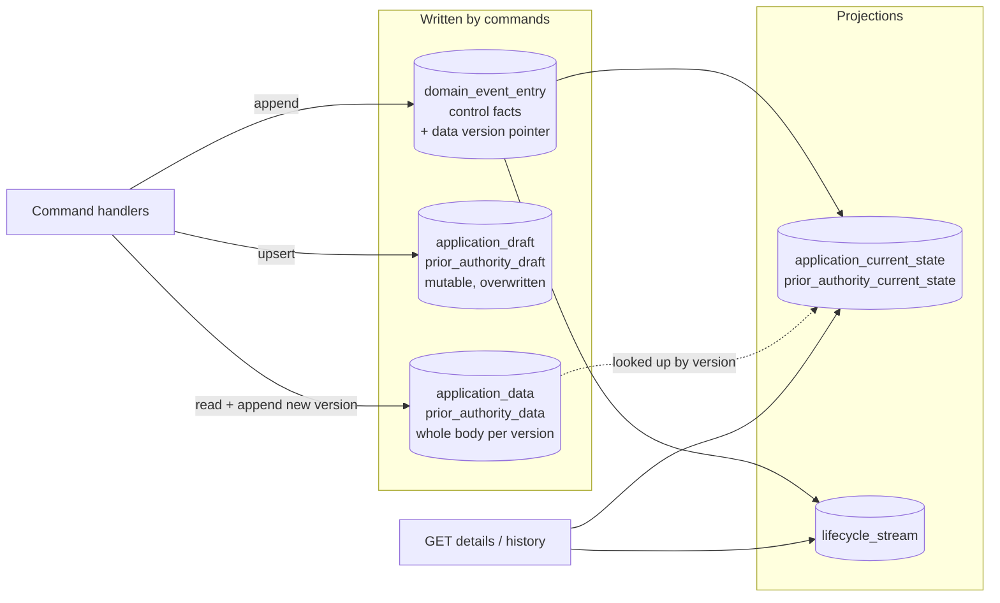
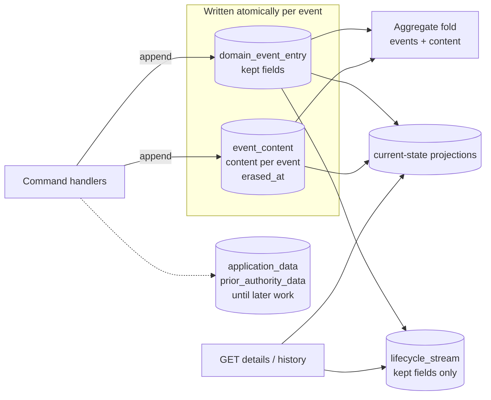

# ADR 0007: Event content is stored beside its event

- Status: Proposed
- Date: 2026-11-17
- Scope: `data-access-service-axon`

## Related papers

- [ADR 0002][sensitive-data-adr]: sensitive application data is stored as immutable versions
  referenced by thin events.
- [ADR 0003][retention-adr]: application behaviour after retention deletion.
- [ADR 0006][genesis-adr]: every event names its genesis.

This ADR records the first layer of the event-scoped sensitive data work: the foundation, with
no change to API behaviour. Prior art is the spike `spike/event-scoped-pii-payloads`
(`docs/spikes/event-scoped-pii.md`, "Gate 4" and "4b-1"). The observations below refer to
`feat/event-content-foundation`, on top of the lifecycle stream work, not a deployed service.

## Context

Axon's event store is append-only and keeps events for as long as the aggregate exists. Anything
an event carries is kept with it, so an event cannot hold data that must later be erased. ADR 0002
moved most application content into `application_data`, but some events still carried content:
potential duplicates, document metadata, Prior Authority document types and decision details.

We want to move more content into the event stream (drafts, submitted applications, Prior
Authorities), so aggregates and queries can read it from one place. That needs a way to keep
content with its event while still being able to erase it, without weakening the guarantee that
every aggregate loads and decides from what remains.

### Why content moves out of the state stores

Today events record what happened, but most content is not in them. It lives in stores that hold
state, not events:

- **Drafts are mutable current state.** `application_draft` and `prior_authority_draft` are
  overwritten in place. A draft event says that something changed, but not what, and the earlier
  content is lost.
- **Submitted content is whole-body versions.** `application_data` and `prior_authority_data`
  store a complete body per data version, and events point at a version instead of carrying the
  facts they introduced.

As a result:

- **The event stream is not the source of truth for content.** Aggregates and read models cannot
  be rebuilt from events alone; replay depends on the side store still holding the pinned version.
- **Concurrency has several versions.** The stream version, the drafts' optimistic-lock versions
  and the data version sequence are separate, alongside the public version.
- **Every change rewrites the whole body.** Updates, decisions and notes each read and append a
  complete new version.
- **Personal data is copied into every version.** Erasure means finding and rewriting every
  version.

**Before:** content is held as state beside the events.

ADS is not in production. Changing how events are stored is cheap now and expensive after
go-live, when stored formats become contracts.

## Decision

Each stored event is split in two when appended. The event keeps only the fields its schema
lists; everything else is **content**, written to `axon.event_content` keyed by event identifier,
inside Axon's append transaction. Erasure replaces the row's content and records when; the row
and the event remain.

The direction is that **each event carries the content it introduced**, beside it in
`event_content` rather than inside it, so erasure can replace content without rewriting immutable
events. The stream becomes the ordered history of content as well as control facts. This layer
builds the mechanism and moves the content events already carry; later layers move drafts and
submitted content onto it. Even then `application_data` and `prior_authority_data` are still
written and GET details still read the current-state projections; removing them is later work.

**After this stack:** events carry their content; the data stores remain until later work.

This has costs: reads must join the two tables consistently, content needs a schema-evolution
policy like kept fields, and aggregates fold content at load time.

### Erasure keeps the row

Direction agreed on 2026-11-09:

- **Soft deletion will be an event.** An erasure request will raise a soft deletion that folds
  and read models treat as erased while the content stays stored.
- **Hard erasure will run automatically** after a retention period. It replaces the row's content
  with `{}` or default content and stamps `erased_at`, once. The row is kept.
- **A missing row is an error, not erased,** whenever the event type has content fields: record
  components its kept-field schema does not list. Readers that join content throw
  `MissingEventContentException`. A field absent from an existing or erased row still reads as
  erased.

This layer adds only the store mechanism: `event_content.erased_at`, a trigger in
`V36__create_event_content.sql` that rejects deletes and every update except that single erasure
transition, and `EventContentStore.erase(eventIds, replacement)`. The soft deletion event,
retention period, scheduler and any erasure endpoint are later work.

### Classification rule

An event keeps only:

1. identity and linking keys: aggregate, document, group, caseworker, work-item and proceeding
   IDs, the LAA reference, and the application IDs its `genesisIds()` derive from (ADR 0006);
2. values a decider rule uses: status, versions, decision outcome, `autoGranted`, schema
   version, request fingerprint, `checksum`, Prior Authority `billingType`;
3. values that decide access or work allocation: `officeCode`, `priorAuthorityType`,
   `workItemType`;
4. the event's own timestamp (`occurredAt`, or `uploadedAt` / `deletedAt` on document events);
5. non-personal decision outcomes, including the decision value for each proceeding, which
   informs retention schedules.

Everything else is content. Usefulness after erasure is not a reason to keep a field; data that
is needed after erasure needs its own solution.

Content fields are typed `Erasable<T>`. Erased is a real state: reading an erased value throws
`ContentErasedException`, so every use of content is visible. Each event's compact constructor
normalises an absent content field to erased, so an event loads whether its row holds the original
content, defaults or `{}` after erasure, and when read with kept fields only.

**Invariant:** with all content erased, every aggregate loads and every command decides as it
would with content. `ErasureReplayTest` folds Application and Prior Authority histories through
the real evolve functions with and without content and compares the states and decider outcomes.
The one deliberate exception is an Application draft: its content is what submit turns into the
Application, so a draft whose content is erased counts as no draft and submit and upload return
not found.

| Event | Content |
|---|---|
| `ApplicationCreated` | `content` (parsed application content), `serialisedRequest`, `potentialDuplicates` (links this person to other applications). Gains the kept `laaReference` and `proceedingIds`. |
| `ApplicationUpdated` | `content`, `serialisedRequest`. Gains the kept `proceedingIds`. |
| `NoteCreated` | `noteText` |
| `ApplicationDecisionMade` | `meritsDecisions`, `certificate`, `serialisedRequest`, `eventDescription`. Gains the kept `decisionRequestFingerprint` and `proceedingDecisions`. |
| `ApplicationDraftStarted` | `applicationContent`, `serialisedRequest`, `potentialDuplicates`. Gains the kept `status` and `laaReference`. |
| `ApplicationDocumentUploaded` | `documentType`, `size`, `contentType`, `sourceService`, `fileSuffix`, `originalFilename` |
| `PriorAuthorityDocumentUploaded` | `size`, `contentType`, `sourceService`, `fileSuffix` |
| `PriorAuthorityDocumentTypeUpdated` | `documentType` |
| `PriorAuthorityDecisionMade` | `decisionJustification`, `amountGranted`, `dateGranted` |
| The other 12 event types | None |

`fileSuffix` can hold part of a filename, so it is content. Once erased, deleting a Prior
Authority document cannot build the SDS filename; that clean-up is best-effort and logged, and
erasure is expected to remove the SDS files itself.

### Kept-field schemas

Every stored event type has an explicit name, `@Event(namespace = "access")`, so the stored type
is `access.<Name>` rather than the Java class name. Each has a JSON Schema at
`src/main/resources/event-schemas/access.<Name>.json` listing exactly its kept fields, with
`additionalProperties: false`. The schema is an allowlist: a field it does not list is content.
Kept fields are validated on append, including formats and enums, so a kept field cannot
silently become free text. An event type without a schema is rejected; there is no report-only
mode. Schema changes change what is kept permanently and need data stewardship review.

Event metadata has the same kind of allowlist: `causationId`, `correlationId`, `X-Service-Name`
and `authenticatedUserId`. The last two identify the actor, not the data subject.

### What has a schema

This design adds one schema per event type: the kept-field allowlist. Content has no schema of
its own; it is whatever the event carries that the allowlist does not list. The other shapes
already existed and change under their own rules.

| Shape | Defined by | Depended on by | How it changes |
|---|---|---|---|
| API requests and responses | OpenAPI under `data-access-api/` | Clients | Coordinated with clients, or deprecated before removal |
| Pact contracts | Consumers' tests, verified in `pactTest` | Clients | Follows the API; Pact never sees events |
| Commands and domain classes | Java | This service only | Refactored freely, unless serialised into events or state stores |
| Kept event fields | `event-schemas/access.<Name>.json` | Stored history, forever | Additive where possible; otherwise an upcaster, with data stewardship review |
| Event content | The event class, minus kept fields | Aggregates and content readers | An upcaster when a field is renamed or retyped; erasure blanks it |
| Read models | Projections | API reads | Rebuilt by replay; no compatibility promise |

The API and event shapes are deliberately separate, so a client-facing rename need not rewrite
stored history, and an event change need not break clients. The risk to watch is a domain class
used directly in both a request and an event: renaming one of its fields changes stored data
too. Kept schemas are strict on purpose, because they are the permanent record. Content is loose
by default, but a renamed content field in old events reads as erased unless an upcaster maps
it.

### One mapper

`EventJson` is the one JSON mapper for event payloads and content, and Axon's `EventConverter` is
built from it. The spike found that Axon's own mapper reads decimals in JSON trees as floating
point, so splitting and rejoining lost `BigDecimal` scale (`1234.50` became `1234.5`). `EventJson`
keeps decimals exact through trees. Anything that parses stored payloads or content, including
`LifecycleStreamReader`, uses the same converter.

### Where it hooks into Axon

The content model and port (`Erasable`, `EventJson`, `EventContentSeparator`,
`EventContentStore`, `RegisteredContentReaders`) are framework-neutral, in `eventcontent`. Only
thin adapters know about Axon (`eventcontent.axon`) or JDBC (`eventcontent.jdbc`).

- **Storage engine decorator.** `ContentSeparatingStorageEngine` wraps Axon's storage engine
  through `registerDecorator`. On append it splits each event and writes content in the same
  transaction, so content and event commit or roll back together, including on append
  conflicts. On sourcing it fetches the aggregate's content in one query by tag and rejoins it
  before conversion, so aggregates load whole. The tag query runs before the events are read, so
  an event committed in between can be missing from it; such an event's row is looked up by event
  ID before sourcing fails.
- **Registered content readers.** The event stream used by processors is passed through
  unchanged, so processors receive kept fields with content erased. Only processors on
  `RegisteredContentReaders` (`application-projection` and `prior-authority-projection`) get an
  event source that rejoins content, and fails on a missing row as sourcing does. Each one added
  must say what content it stores and how erasure reaches it. Subscribing processors receive the
  published event with content, but do not read it.
- **Lifecycle stream.** `lifecycle-stream` and application history need no content.
  `LifecycleStreamReader` decodes stored rows as Axon does, so content fields read as erased.

`EventContentArchitectureTest` enforces that every event has a schema matching its kept record
components; only `eventcontent`, `*Evolve`, `ApplicationProjection` and `PriorAuthorityProjection`
read `Erasable` values; only `eventcontent` adapters and processor configuration use the content
store and Axon adapter; and nothing declares snapshots.

### No snapshots

A snapshot would serialise the whole aggregate, content included, into a store erasure does not
reach. Axon 5.4 snapshots are opt-in and none are declared. The spike measured loads of up to 101
events at about 9 ms locally, with history length adding little, so snapshots are not needed.
Snapshots require an erasure design first.

## Alternatives considered

- **Keep all content in side stores (ADR 0002 only):** rejected as the long-term model. Every
  reader must join to the store by version, and content an event does carry is permanent.
- **Split in Axon's serialiser:** rejected. It needs one content query per event and cannot tell
  processors apart.
- **A custom repository:** rejected. It does not cover event processors.
- **Configure only the split's mapper, or split raw bytes:** rejected in favour of one mapper we
  own, so Axon and the split cannot disagree.
- **A report-only mode for unclassified events:** rejected. Every type is classified from the
  data reset.
- **Encrypt content in the event and destroy the key (crypto-shredding):** rejected, as in ADR
  0002. Destroying a key is a recognised way to put data beyond use, but the ciphertext stays in
  the event store and every backup indefinitely, so erasure depends on the key never resurfacing
  from a backup, a leak or future cryptanalysis. It needs per-subject key ownership, rotation,
  backup, audit and partial decryption, and it does not reach the plaintext copies in
  projections, read models and SDS, which need erasing anyway. Crypto-shredding is usually chosen
  because events cannot be changed; keeping content in its own row lets us blank it directly.

## Consequences

- **One-off data reset.** Stored type names change from Java class names to `access.<Name>`,
  and Axon's mapper changes, so events stored before this change no longer load. ADS has no
  production data. The whole stack (genesis IDs, lifecycle stream, event content) is deployed
  together with one reset of each environment's `axon` schema: the event store, processor
  tokens, projections, lifecycle stream and the sensitive-data stores (`application_data`,
  drafts, Prior Authority data) are emptied together. Migrations contain no destructive SQL;
  `V36__create_event_content.sql` only creates the content table and its guard trigger. As V36
  has not been deployed, the erasure column and trigger are part of it rather than a new
  migration.
- After go-live, every stored format becomes a contract needing upcasting or migration.
- New event types need an explicit `@Event` name, a schema and a classification review; the build
  enforces the first two.
- Every aggregate load runs one indexed content query, plus a lookup by event ID for any event of
  a type with content fields that the query missed. Each event streamed to a registered content
  reader runs one. Batch these only if measurements show a need.
- A lost content row stops the aggregate loading and stalls a content-reading processor, rather
  than silently reading as erased.
- The design relies on Axon's decorator hook, its tags and sourcing criteria, and the observed
  behaviour that the JPA engine appends inside a Spring transaction. The framework-neutral port
  limits how much would move if that changed.
- `ApplicationHistoryMapper` reads only kept fields, including `PriorAuthoritySubmitted`'s
  `priorAuthorityType` and the work-item events' `applicationId`.

## Later layers

This layer moves no content into events that was not there already. Later layers:

1. move draft content into events and remove `ApplicationDraftStore` (done: Application draft
   content and upload filenames are event content; submit and the upload pre-check read the draft
   from the aggregate, and the projection records draft filenames for document downloads);
2. move submitted content into events (done: created, updated, note and decision content is event
   content, and command handlers build the next `application_data` version from aggregate state;
   `application_data` is still written and still serves API reads, projections and history
   descriptions); reading application details from the aggregate and removing
   `ApplicationDataStore` is later work;
3. do the same for Prior Authority drafts, submissions and decisions;
4. build erasure on the store mechanism: the soft deletion event, the retention period and the
   automatic hard erasure.

When the old stores are gone, ADR 0002 is superseded.

## Reconsider when

- A rule needs to decide from content, or a kept field turns out to be personal data.
- Content or history grows enough that load cost matters.
- Snapshots are needed.
- Axon changes the storage engine, its transaction behaviour or its sourcing criteria.

[sensitive-data-adr]: 0002-separate-sensitive-data-from-domain-events.md
[retention-adr]: 0003-define-application-behaviour-after-retention-deletion.md
[genesis-adr]: 0006-every-event-names-its-genesis.md
