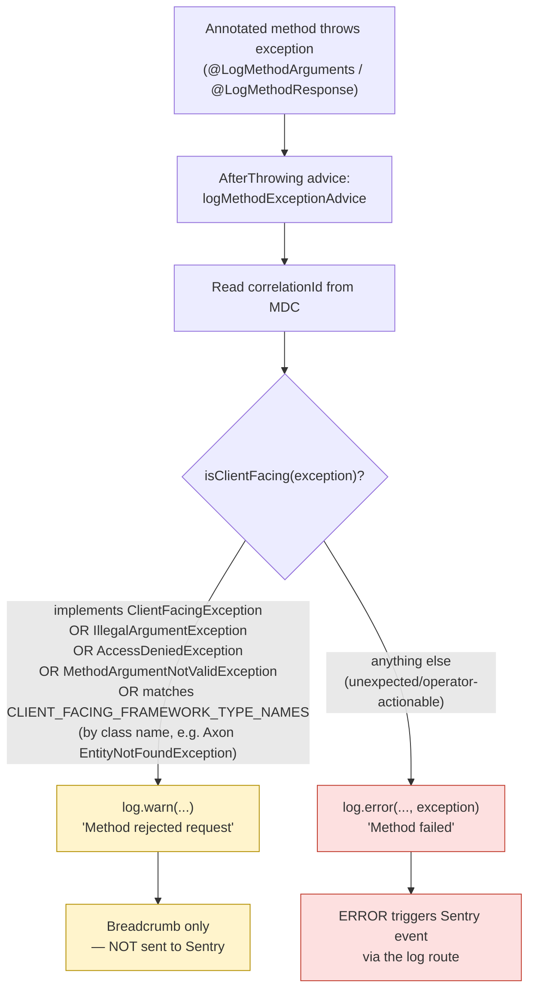

# Error Reporting Process

## Overview

Sentry receives errors from this service through two underlying routes, configured via
`sentry-logback` and the Spring Boot Sentry integration (see `application.yml`, the Helm
`_envs.tpl` template, and `build.gradle` for the exact wiring):

- **Logs** — `sentry-logback` turns any `ERROR`-level log line into a Sentry event
  (`minimum-event-level: error`). Recent `INFO` logs are attached as breadcrumbs.
- **Unhandled exceptions** — the Spring Boot integration reports these automatically.

What this document describes is the **application-level rule for what gets routed to which
outcome** — every exception in this codebase is deliberately classified as either an expected,
client-caused failure (breadcrumb-only `WARN`/`INFO`) or an unexpected, operator-actionable
failure (a Sentry event, via `ERROR`). That classification happens at one of seven well-defined
points in the code, described as Paths A–G below. The full agreed policy, with its enforcement
mechanisms and a checklist for adding new exceptions, is maintained in
`docs/observability-sentry-policy.md` at the repository root; this document gives the detailed,
code-level walkthrough of each path for engineers and reviewers.

### The central primitive — `ErrorReporter`

`uk.gov.justice.laa.dstew.access.observability.ErrorReporter#report(String message, Throwable
throwable)` is the single method responsible for turning a failure into a Sentry event. It logs the
throwable at `ERROR` — picked up by `sentry-logback` — **unless it has already been reported**:
a cheap, stack-trace-free marker exception is suppressed onto the throwable
(`Throwable#addSuppressed`) the first time it is reported, and checked by reference equality on
subsequent calls. This means multiple boundaries in a call chain (e.g. a `*DataStore` and an outer
HTTP handler) can both call `report(...)` defensively on the same exception instance without
producing a duplicate Sentry event.

Every path below funnels through this one method, with one documented exception
(`LoggingAspects`, Path D), which cannot depend on it for module-layering reasons.

## The seven error-reporting paths

| Path | Trigger | Outcome | Key class/method |
|---|---|---|---|
| A | Expected HTTP failure (4xx) | breadcrumb only | `ApplicationExceptionHandler` (`log.warn` handlers) |
| B | Unexpected HTTP failure (5xx) | Sentry event | `ApplicationExceptionHandler` (`ErrorReporter.report` handlers) |
| C | Unmapped `RuntimeException` reaching a controller | Sentry event | `ApplicationExceptionHandler.handleUnexpectedException` |
| D | Exception from a `@LogMethodArguments`/`@LogMethodResponse` method | WARN or ERROR, by classification | `LoggingAspects.logMethodExceptionAdvice` |
| E | Background (pooled-streaming) Axon projection failure | Sentry event, cooldown-limited | `ReportingErrorHandler.handleError` |
| F | Data-integrity anomaly found during event replay (no throw) | Sentry event | `WorkListProjection`, `PriorAuthorityHistoryProjection` |
| G | Scheduled job failure | Sentry event, not rethrown | `AssessmentReconciliation.run` |

---

### Path A — Expected HTTP outcome (4xx), breadcrumb only

**Trigger:** domain/validation logic raises a conflict, not-found, or bad-input exception that is a
known, client-caused outcome.

**Flow:**

```
Service/aggregate throws e.g. PriorAuthorityVersionConflictException
  → ApplicationExceptionHandler.handlePriorAuthorityVersionConflictException(exception)
       log.warn("Prior authority version conflict: {}", exception.getMessage())
       returns ResponseEntity 409
  → sentry-logback does NOT escalate (WARN < minimum-event-level: error)
  → the log line is still retained in Sentry's breadcrumb buffer, so if a *later*
    event in the same request/session does trigger an event, this WARN line
    appears as recent context
```

**Why this matters:** this is the deliberate fix to the historical inconsistency where some
handlers logged `ERROR` for routine 4xx outcomes. Each handler now hard-codes its severity rather
than relying on a generic catch-all, so correctness can be checked per-exception-type by reading
one line per handler. Examples in this class: `handleValidationException`,
`handleResourceNotFoundException`, `handleApplicationLinkConflictException`,
`handleApplicationCreationConflictException`, `handlePriorAuthorityStatusConflictException`,
`handleWorkItemAssignmentConflictException`, and others.

**Test coverage:** `ApplicationExceptionHandlerTest` asserts the correct HTTP status per handler;
`ApplicationExceptionHandlerLoggingArchTest` enforces structurally that every handler calls
`log.warn`/`log.error`/`ErrorReporter.report`, so a future handler can't silently do neither.

---

### Path B — Unexpected HTTP outcome (5xx), explicit `ErrorReporter.report`

**Trigger:** a downstream/infrastructure failure that is not the caller's fault but prevents
completing the request — e.g. SDS token acquisition, an unexpected virus-scan result, or an
application-history data-integrity violation.

**Flow:**

```
SdsService → ClientAuthorizationException escapes (token endpoint unreachable)
  → ApplicationExceptionHandler.handleClientAuthorizationException(exception)
       errorReporter.report("Failed to obtain access token for an external service", exception)
         → ErrorReporter.report: not yet reported (no ReportedMarker suppressed)
             → throwable.addSuppressed(ReportedMarker.INSTANCE)
             → log.error(message, throwable)       // picked up by sentry-logback → Sentry event
       returns ResponseEntity 500 (generic detail, no internals leaked)
```

**Why `errorReporter.report` and not `log.error` directly:** centralising the call means the dedup
marker is always applied — if this same exception instance had already passed through a
`*DataStore` that reported it, the second `report(...)` call here is a safe no-op rather than a
duplicate Sentry event. Examples in this class: `handleVirusScanException`,
`handleClientAuthorizationException`, `handleApplicationHistoryIntegrityException`.

**Test coverage:** `ApplicationExceptionHandlerTest` verifies `errorReporter.report(...)` is
invoked with the expected message/exception for each of these handlers.

---

### Path C — The generic backstop (`handleUnexpectedException`)

**Trigger:** any `RuntimeException` not matched by a more specific `@ExceptionHandler` — the case
the "Spring Boot integration reports these automatically" route historically described.

**Flow:**

```
Controller method throws an unanticipated RuntimeException (e.g. a bug, NPE, unmapped library exception)
  → ApplicationExceptionHandler.handleUnexpectedException(RuntimeException exception)
       errorReporter.report("Unexpected error handling request", exception)
       returns generic 500 ProblemDetail, instance=about:blank (no stack trace/detail leaked to caller)
```

**Key design decision — why `RuntimeException`, not `Exception`:** Spring MVC's own
request-binding failures (e.g. a missing required parameter) throw *checked* `ServletException`
subtypes. If this handler were scoped to `Exception`, it would intercept those too and return a
generic 500 instead of Spring's correct 400. Scoping to `RuntimeException` means this handler only
ever catches genuinely unexpected application-level failures, and Spring's own exception resolution
still handles its own framework-level errors correctly.

**Relationship to the native Spring Boot auto-reporting route:** this handler pre-empts that
integration for everything that reaches a controller — so by the time Spring Boot's automatic
reporting would normally kick in (for anything escaping all `@ExceptionHandler`s), this project has
already converted and reported it consistently. The native Spring Boot auto-reporting is now
effectively a last-resort fallback for exceptions thrown entirely outside Spring MVC's dispatch
(e.g. filter-chain failures before the `DispatcherServlet`), not the primary mechanism it used to
be.

**Note for reviewers:** unlike `ReportingErrorHandler` (Path E), this call to
`errorReporter.report(...)` is not itself wrapped in a try/catch — if the reporting call throws
(e.g. Sentry transport failure), that exception would propagate instead of the generic 500 being
returned. Worth confirming whether this asymmetry with Path E's defensive handling is acceptable.

**Test coverage:** `ApplicationExceptionHandlerTest` asserts a plain `RuntimeException` triggers
`errorReporter.report("Unexpected error handling request", exception)` and a 500 response.

---

### Path D — AOP default classification (`LoggingAspects`)

**Trigger:** any exception thrown from inside a method annotated `@LogMethodArguments`/
`@LogMethodResponse` that isn't already handled by `ApplicationExceptionHandler` further up the
stack (e.g. service-layer methods called before the result reaches a controller, or methods in
modules that don't go through the exception handler at all).

`LoggingAspects` is a Spring AOP aspect
(`data-access-shared/src/main/java/uk/gov/justice/laa/dstew/access/shared/logging/aspects/LoggingAspects.java`)
that wraps any method annotated with `@LogMethodArguments` and/or `@LogMethodResponse`. Beyond
logging method entry/exit, its `@AfterThrowing` advice (`logMethodExceptionAdvice`) intercepts
**every exception thrown by an annotated method** and classifies it into one of two reporting paths
before it propagates further up the call stack. The exception is logged, not swallowed — it still
propagates normally after the advice runs.

#### Why this exists

Not every exception represents an operational problem. A validation failure or "resource not
found" is an expected, caller-driven outcome (HTTP 4xx) — it doesn't need an engineer paged or a
Sentry alert. A null pointer exception, a database timeout, or an unhandled bug, however, is
operator-actionable (HTTP 5xx) and should surface loudly. This aspect encodes that distinction in
one place so every annotated method doesn't have to re-implement it.

**Why this remains a second `log.error` call site (alongside `ErrorReporter`):**
`data-access-shared` is a lower-level module that cannot depend on `ErrorReporter` (which lives in
`data-access-service-axon`). This aspect is the closest equivalent mechanism for that layer, and is
the one documented, allow-listed exception in
`AxonArchitectureTest.onlyErrorReporterMayLogAtErrorLevel`.

#### The classification rule — `isClientFacing(Throwable)`

```java
private boolean isClientFacing(Throwable exception) {
  return exception instanceof ClientFacingException
      || exception instanceof IllegalArgumentException
      || exception instanceof AccessDeniedException
      || exception instanceof MethodArgumentNotValidException
      || CLIENT_FACING_FRAMEWORK_TYPE_NAMES.contains(exception.getClass().getName());
}
```

An exception is treated as **client-facing** (expected) if **any** of the following is true:

| # | Condition | Why |
|---|-----------|-----|
| 1 | Implements the marker interface `ClientFacingException` | First-party exceptions in this codebase opt in explicitly by implementing this interface — a deliberate, compile-time-checked signal that the exception maps to a 4xx response. |
| 2 | Is (or subclasses) `IllegalArgumentException` | Common JDK idiom for "caller supplied a bad argument." |
| 3 | Is (or subclasses) Spring Security's `AccessDeniedException` | Caller lacks permission — a 403, not a bug. |
| 4 | Is (or subclasses) `MethodArgumentNotValidException` | Spring's `@Valid` request-body validation failure — a 400. |
| 5 | Its **fully-qualified class name** matches an entry in `CLIENT_FACING_FRAMEWORK_TYPE_NAMES` | Covers third-party exceptions this shared module can't declare a compile-time dependency on (currently two Axon Framework exceptions: `EntityNotFoundException` and `EntityMissingForInstanceCommandHandlerException`). Matched **by name**, not `instanceof`, precisely because Axon isn't a dependency of `data-access-shared`. |

If none of these match, the exception is treated as **unexpected/operator-actionable**.

#### Diagram



#### The two sub-paths

**D1 — Client-facing (WARN, no Sentry)**

```java
log.warn(
    "Method rejected request: class={}, method={}, exceptionType={}, exceptionMessage={}, correlationId={}",
    ...);
return;
```

- Logged at **WARN**.
- Message is prefixed `"Method rejected request"`.
- Includes `class`, `method`, `exceptionType` (simple name), `exceptionMessage`, `correlationId` —
  **no stack trace is attached**.
- Because the log route only forwards `ERROR` to Sentry, this never creates a Sentry event. It's a
  breadcrumb for correlating what happened around an incident, not an alert itself.

**D2 — Unexpected (ERROR, Sentry event)**

```java
log.error(
    "Method failed: class={}, method={}, exceptionType={}, exceptionMessage={}, correlationId={}",
    ..., exception);
```

- Logged at **ERROR**.
- Message is prefixed `"Method failed"`.
- Same structured fields as D1, **plus** the `exception` object itself passed as the final varargs
  argument — this attaches the full stack trace to the log event.
- The log route treats ERROR as Sentry-reportable, so this raises an alert/event with full trace
  context.

Both sub-paths always include the `correlationId` pulled from MDC (`MDC.get("correlationId")`), so
WARN and ERROR entries can be correlated with the rest of the request's log trail (including the
request-logging filter's entries) regardless of which path was taken.

#### Example paths through the code

**Example 1 — Validation failure (client-facing)**

```java
@LogMethodArguments
public void createApplication(ApplicationRequest request) {
  if (request.getReference() == null) {
    throw new IllegalArgumentException("reference must not be null");
  }
  ...
}
```

→ `IllegalArgumentException` matches rule #2 → **WARN**, log reads:

```
Method rejected request: class=ApplicationService, method=createApplication,
exceptionType=IllegalArgumentException, exceptionMessage=reference must not be null,
correlationId=abc-123
```

No Sentry event. No stack trace logged.

**Example 2 — Domain "already exists" exception (client-facing, first-party)**

```java
public class ApplicationAlreadyExistsException extends RuntimeException
    implements ClientFacingException { ... }
```

Thrown from an annotated method → matches rule #1 → **WARN**, same shape as above but
`exceptionType=ApplicationAlreadyExistsException`.

**Example 3 — Access denied (client-facing)**

```java
throw new AccessDeniedException("caller lacks APPLICATION_WRITE role");
```

→ matches rule #3 → **WARN**, no Sentry event, maps to an HTTP 403 upstream.

**Example 4 — Spring `@Valid` request body failure (client-facing)**

A controller method annotated with `@LogMethodArguments` whose `@RequestBody @Valid` argument
fails validation → Spring throws `MethodArgumentNotValidException` → matches rule #4 → **WARN**.

**Example 5 — Axon aggregate not found (client-facing, matched by name)**

```java
throw new org.axonframework.modelling.repository.EntityNotFoundException("aggregate missing");
```

This class is **not** imported or checked via `instanceof` in `LoggingAspects` (no compile-time
dependency on Axon from `data-access-shared`). Instead, `exception.getClass().getName()` is
compared against the string `"org.axonframework.modelling.repository.EntityNotFoundException"` in
the `CLIENT_FACING_FRAMEWORK_TYPE_NAMES` set → matches rule #5 → **WARN**.

⚠️ *Caveat:* this match is exact-class-name based, not polymorphic — a subclass of this Axon
exception would **not** match and would fall through to the ERROR path.

**Example 6 — Unexpected runtime failure (operator-actionable)**

```java
public void processPayment(PaymentRequest request) {
  paymentGateway.charge(request); // throws RuntimeException: connection refused
}
```

`RuntimeException` doesn't match any of the five rules → falls to the `else` branch → **ERROR**,
full stack trace attached, Sentry event created:

```
Method failed: class=PaymentService, method=processPayment,
exceptionType=RuntimeException, exceptionMessage=Connection refused,
correlationId=abc-123
<stack trace>
```

**Example 7 — Null pointer / programming bug (operator-actionable)**

An uncaught `NullPointerException` from a bug in business logic → doesn't match any client-facing
rule → **ERROR** path, Sentry event, full stack trace — exactly the "operator needs to look at
this" signal the design intends.

#### Summary table

| Exception thrown | Matches rule | Log level | Sentry? | Stack trace logged? |
|---|---|---|---|---|
| Implements `ClientFacingException` | #1 | WARN | No | No |
| `IllegalArgumentException` | #2 | WARN | No | No |
| `AccessDeniedException` | #3 | WARN | No | No |
| `MethodArgumentNotValidException` | #4 | WARN | No | No |
| Axon `EntityNotFoundException` (exact class name) | #5 | WARN | No | No |
| Anything else (`RuntimeException`, `NullPointerException`, infra errors, etc.) | none | ERROR | **Yes** | Yes |

**Test coverage:** `LoggingAspectsTest` — `givenClientFacingException_whenThrown_thenLogsAtWarn`,
`givenIllegalArgumentException_whenThrown_thenLogsAtWarn`,
`givenAccessDeniedException_whenThrown_thenLogsAtWarn`,
`givenMethodArgumentNotValidException_whenThrown_thenLogsAtWarn`,
`givenFrameworkClientFacingExceptionByName_whenThrown_thenLogsAtWarn`,
`givenUnclassifiedRuntimeException_whenThrown_thenLogsAtError` — one test per branch of the
classification logic.

---

### Path E — Background Axon projection failure (`ReportingErrorHandler`)

**Trigger:** a pooled-streaming (background) event-processor segment throws while applying an
event — no HTTP caller exists to propagate the failure back to.

**Flow:**

```
Pooled-streaming processor (e.g. workListProjectionProcessor) applies an event,
WorkListProjection.on(...) throws
  → Axon's WorkPackage invokes the configured ErrorHandler = ReportingErrorHandler
  → ReportingErrorHandler.handleError(errorContext)
       try { maybeReport(errorContext) } catch (RuntimeException) { LOG.warn(...) }  // reporting itself must never block Axon's handling
       delegate.handleError(errorContext)   // the real PropagatingErrorHandler: rethrow/retry/abort as normal
```

```
maybeReport(errorContext):
  key = eventProcessor + "::" + exceptionClassName
  if lastReportedAt[key] within cooldown (default 5m, configurable via
     application.error-reporting.axon-projection-cooldown) → skip, log.debug suppression note
  else:
     lastReportedAt[key] = now
     errorReporter.report(
       "Event processor [%s] failed to process %d event(s)".formatted(processorName, failedEvents.size()),
       errorContext.error())
```

**Why a cooldown:** Axon retries a failing segment repeatedly; without the cooldown, a persistent
failure would fire one Sentry event per retry (noisy, costly, and would mask the "interesting" first
occurrence). The cooldown key is `(processor, exceptionType)` so two *different* faults on the same
processor (or the same fault on two different processors) are reported independently rather than
one suppressing the other.

**Why reporting failures never block the real handler:** `handleError` wraps `maybeReport` in its
own try/catch — if Sentry/the reporting path itself throws (e.g. a network issue), Axon's own
rethrow/retry/abort semantics (`delegate.handleError`) still execute unconditionally. This stops an
observability failure from becoming a correctness/availability failure.

**Why subscribing processors are excluded:** `AxonEventProcessingConfig` wires
`ReportingErrorHandler` only into `pooledStreamingProcessor(...)` (used by all current
pooled-streaming beans — `applicationProjectionProcessor`, `workListProjectionProcessor`,
`priorAuthorityProjectionProcessor`, `linkedApplicationGroupProjectionProcessor`,
`linkedGroupWorkItemLifecycleProcessor`, `applicationHistoryProjectionProcessor`). The subscribing
beans (`applicationGroupRouteProcessor`, `workItemRouteProcessor`,
`applicationSubmittedPublisherProcessor`) keep `PropagatingErrorHandler.instance()` directly — their
failures propagate synchronously back through the originating command's call stack to the HTTP
boundary (Paths B/C), so reporting them again here would double-report the same failure via two
different Sentry events.

**Test coverage:** `ReportingErrorHandlerTest` —
`givenFirstFailure_whenHandled_thenReportsAndDelegates`,
`givenSecondFailureWithinCooldown_whenHandled_thenDoesNotReportAgainButStillDelegates`,
`givenCooldownElapsed_whenHandled_thenReportsAgain`,
`givenDifferentProcessor_whenHandled_thenReportsIndependently`,
`givenDifferentExceptionType_whenHandled_thenReportsIndependently`,
`givenDelegateThrows_whenHandled_thenExceptionPropagates` (confirms Axon's own semantics are
preserved even on failure), `givenReportingThrows_whenHandled_thenDelegateIsStillInvoked` (confirms
reporting failures don't block delegation), `givenMultipleFailedEvents_whenHandled_thenReportsOnlyOnce`.
`AxonEventProcessingConfigTest` separately confirms the *wiring* — pooled-streaming beans use
`ReportingErrorHandler`, subscribing beans use `PropagatingErrorHandler`.

---

### Path F — Data-integrity anomaly detected during event replay (no exception thrown)

**Trigger:** a projection event handler receives an event that references an entity it can't
find — this is a "the write side and read side have become inconsistent" signal, not a transient
failure, so the handler can't simply throw (that would abort/retry the segment pointlessly) but
must still make the anomaly visible.

**Flow (`WorkListProjection`):**

```java
on(WorkItemAssigned event, EventMessage message):
  items.findById(event.workItemId())
    .ifPresentOrElse(
        item -> { update + save },
        () -> errorReporter.report(
                "Cannot assign missing work-list item",
                new IllegalStateException(
                    "Missing work-list item for assignment: id=%s, type=%s"
                      .formatted(event.workItemId(), event.workItemType()))));
```

Same shape in `on(WorkItemUnassigned event, EventMessage message)` ("Cannot unassign missing
work-list item").

**Flow (`PriorAuthorityHistoryProjection`):** when the prior-authority data referenced by an
assignment/unassignment event can't be found:

```java
errorReporter.report(
    "Prior authority data not found for PA assignment event",   // or "...unassignment event"
    new ApplicationHistoryIntegrityException(null, event.workItemId(),
        "no prior-authority data for version=" + event.itemVersion()));
return;   // handler returns normally — event processing continues
```

**Why this is still routed through `ErrorReporter` rather than, say, `log.warn`:** this is an
operator-actionable, unexpected condition (a real inconsistency between aggregates and read models)
even though it doesn't throw — it needs the same visibility as any other unexpected failure, just
without aborting replay of subsequent events.

**Test coverage:** `WorkListProjectionTest` —
`givenMissingWorkItem_whenAssigned_thenReportsAndDoesNotSave` /
`givenMissingWorkItem_whenUnassigned_thenReportsAndDoesNotSave`, asserting
`verify(errorReporter).report(eq("Cannot assign/unassign missing work-list item"), any())` and that
`items.save(...)` is never called. `PriorAuthorityHistoryProjectionTest` has the analogous pair for
the assignment/unassignment-without-data case.

---

### Path G — Scheduled job failure, reported without rethrowing

**Trigger:** `AssessmentReconciliation.run()` (a `@Scheduled` method) fails while querying for
stalled assessments.

**Flow:**

```java
run():
  try {
    StalledAssessments result = queryGateway.query(new FindStalledAssessmentsQuery(...), ...);
    // ... iterate and warn-log individual stalled assessments via private report(...) — an
    // unrelated helper method name clash; it logs WARN per stalled item as a business signal, not
    // a failure ...
  } catch (Exception exception) {
    errorReporter.report("Automatic-assessment reconciliation failed", exception);
    // deliberately not rethrown
  }
```

**Why not rethrow:** Spring's `@Scheduled` infrastructure already logs any exception that escapes a
scheduled method at `ERROR` by default. If this method rethrew after calling
`errorReporter.report(...)`, the same failure would be reported twice — once via `ErrorReporter`'s
`log.error` call, and once via Spring's own scheduler error-handling `log.error` call outside this
codebase (which `ErrorReporter`'s dedup marker cannot prevent, since it's a separate logging call
site entirely, not a second call to `ErrorReporter.report`). Swallowing after reporting keeps it to
exactly one Sentry event.

**Test coverage:** `AssessmentReconciliationTest` — verifies
`errorReporter.report("Automatic-assessment reconciliation failed", exception)` is called when the
query throws, and that `run()` completes without propagating the exception (confirming the
scheduler won't see it a second time).

---

## Cross-cutting observations for review

- **Single reporting primitive, many call sites:** every path above funnels through exactly one
  method, `ErrorReporter.report(String, Throwable)` — checking "is this genuinely reported once"
  only ever requires reasoning about that one method's dedup logic, not seven different ad-hoc
  mechanisms.
- **Dedup is structural, not a convention:** the suppressed-marker technique means a developer
  adding a new call to `errorReporter.report(...)` on a throwable that might already have passed
  through another boundary doesn't need to know that in advance — the no-op is automatic, and both
  inner (`*DataStore`) and outer (`handleUnexpectedException`) layers can call `report(...)` safely
  on the same instance.
- **Reporting is deliberately isolated from the thing it reports on:** Path E's
  `ReportingErrorHandler.handleError` specifically guards against a reporting-infrastructure fault
  (e.g. Sentry down) ever changing Axon's retry/abort behaviour. Path C
  (`handleUnexpectedException`) does not have the same defensive wrapping — worth a reviewer check
  on whether that asymmetry is acceptable.

## Enforcement

| Test | Guards against |
|---|---|
| `AxonArchitectureTest.onlyErrorReporterMayLogAtErrorLevel` | any class other than `ErrorReporter`/`LoggingAspects` calling `Logger.error(...)` directly |
| `AxonArchitectureTest.dataStoreClassesMustDependOnErrorReporter` | a new `*DataStore` class forgetting to wire `ErrorReporter` |
| `ApplicationExceptionHandlerLoggingArchTest.exceptionHandlerMethodsMustExplicitlyChooseReportingSeverity` | a new `@ExceptionHandler` method not calling `log.warn`/`log.error`/`ErrorReporter.report` |

See `docs/observability-sentry-policy.md` (repository root) for the full agreed policy, the
reporting-outcome table, and the checklist for adding a new exception or handler.
