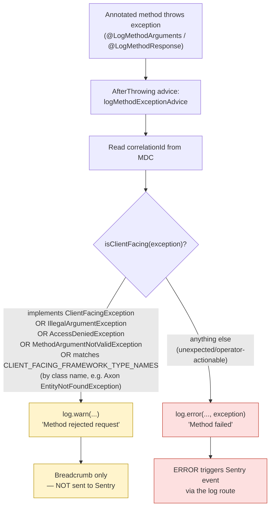

# Error Reporting Process — `LoggingAspects` Exception Classification

## Overview

`LoggingAspects` is a Spring AOP aspect
(`data-access-shared/src/main/java/uk/gov/justice/laa/dstew/access/shared/logging/aspects/LoggingAspects.java`)
that wraps any method annotated with `@LogMethodArguments` and/or `@LogMethodResponse`. Beyond
logging method entry/exit, its `@AfterThrowing` advice (`logMethodExceptionAdvice`) intercepts
**every exception thrown by an annotated method** and classifies it into one of two reporting
paths before it propagates further up the call stack. This classification determines whether the
failure becomes a **Sentry event** or stays a **breadcrumb-only log line**.

The exception is logged, not swallowed — it still propagates normally after the advice runs.

## Why this exists

Not every exception represents an operational problem. A validation failure or "resource not
found" is an expected, caller-driven outcome (HTTP 4xx) — it doesn't need an engineer paged or a
Sentry alert. A null pointer exception, a database timeout, or an unhandled bug, however, is
operator-actionable (HTTP 5xx) and should surface loudly. This aspect encodes that distinction in
one place so every service doesn't have to re-implement it.

## The classification rule — `isClientFacing(Throwable)`

```java
private boolean isClientFacing(Throwable exception) {
  return exception instanceof ClientFacingException
      || exception instanceof IllegalArgumentException
      || exception instanceof AccessDeniedException
      || exception instanceof MethodArgumentNotValidException
      || CLIENT_FACING_FRAMEWORK_TYPE_NAMES.contains(exception.getClass().getName());
}
```

An exception is treated as **client-facing** (expected) if **any** of the following is true:

| # | Condition | Why |
|---|-----------|-----|
| 1 | Implements the marker interface `ClientFacingException` | First-party exceptions in this codebase opt in explicitly by implementing this interface — a deliberate, compile-time-checked signal that the exception maps to a 4xx response. |
| 2 | Is (or subclasses) `IllegalArgumentException` | Common JDK idiom for "caller supplied a bad argument." |
| 3 | Is (or subclasses) Spring Security's `AccessDeniedException` | Caller lacks permission — a 403, not a bug. |
| 4 | Is (or subclasses) `MethodArgumentNotValidException` | Spring's `@Valid` request-body validation failure — a 400. |
| 5 | Its **fully-qualified class name** matches an entry in `CLIENT_FACING_FRAMEWORK_TYPE_NAMES` | Covers third-party exceptions this shared module can't declare a compile-time dependency on (currently two Axon Framework exceptions: `EntityNotFoundException` and `EntityMissingForInstanceCommandHandlerException`). Matched **by name**, not `instanceof`, precisely because Axon isn't a dependency of `data-access-shared`. |

If none of these match, the exception is treated as **unexpected/operator-actionable**.

## Diagram



## The two paths

### Path A — Client-facing (WARN, no Sentry)

```java
log.warn(
    "Method rejected request: class={}, method={}, exceptionType={}, exceptionMessage={}, correlationId={}",
    ...);
return;
```

- Logged at **WARN**.
- Message is prefixed `"Method rejected request"`.
- Includes `class`, `method`, `exceptionType` (simple name), `exceptionMessage`, `correlationId` —
  **no stack trace is attached**.
- Because the log route only forwards `ERROR` to Sentry, this never creates a Sentry event. It's a
  breadcrumb for correlating what happened around an incident, not an alert itself.

### Path B — Unexpected (ERROR, Sentry event)

```java
log.error(
    "Method failed: class={}, method={}, exceptionType={}, exceptionMessage={}, correlationId={}",
    ..., exception);
```

- Logged at **ERROR**.
- Message is prefixed `"Method failed"`.
- Same structured fields as Path A, **plus** the `exception` object itself passed as the final
  varargs argument — this attaches the full stack trace to the log event.
- The log route treats ERROR as Sentry-reportable, so this raises an alert/event with full trace
  context.

Both paths always include the `correlationId` pulled from MDC (`MDC.get("correlationId")`), so
WARN and ERROR entries can be correlated with the rest of the request's log trail (including the
request-logging filter's entries) regardless of which path was taken.

## Example paths through the code

**Example 1 — Validation failure (client-facing)**

```java
@LogMethodArguments
public void createApplication(ApplicationRequest request) {
  if (request.getReference() == null) {
    throw new IllegalArgumentException("reference must not be null");
  }
  ...
}
```

→ `IllegalArgumentException` matches rule #2 → **WARN**, log reads:

```
Method rejected request: class=ApplicationService, method=createApplication,
exceptionType=IllegalArgumentException, exceptionMessage=reference must not be null,
correlationId=abc-123
```

No Sentry event. No stack trace logged.

**Example 2 — Domain "already exists" exception (client-facing, first-party)**

```java
public class ApplicationAlreadyExistsException extends RuntimeException
    implements ClientFacingException { ... }
```

Thrown from an annotated method → matches rule #1 → **WARN**, same shape as above but
`exceptionType=ApplicationAlreadyExistsException`.

**Example 3 — Access denied (client-facing)**

```java
throw new AccessDeniedException("caller lacks APPLICATION_WRITE role");
```

→ matches rule #3 → **WARN**, no Sentry event, maps to an HTTP 403 upstream.

**Example 4 — Spring `@Valid` request body failure (client-facing)**

A controller method annotated with `@LogMethodArguments` whose `@RequestBody @Valid` argument
fails validation → Spring throws `MethodArgumentNotValidException` → matches rule #4 → **WARN**.

**Example 5 — Axon aggregate not found (client-facing, matched by name)**

```java
throw new org.axonframework.modelling.repository.EntityNotFoundException("aggregate missing");
```

This class is **not** imported or checked via `instanceof` in `LoggingAspects` (no compile-time
dependency on Axon from `data-access-shared`). Instead, `exception.getClass().getName()` is
compared against the string `"org.axonframework.modelling.repository.EntityNotFoundException"` in
the `CLIENT_FACING_FRAMEWORK_TYPE_NAMES` set → matches rule #5 → **WARN**.

⚠️ *Caveat:* this match is exact-class-name based, not polymorphic — a subclass of this Axon
exception would **not** match and would fall through to Path B (ERROR).

**Example 6 — Unexpected runtime failure (operator-actionable)**

```java
public void processPayment(PaymentRequest request) {
  paymentGateway.charge(request); // throws RuntimeException: connection refused
}
```

`RuntimeException` doesn't match any of the five rules → falls to the `else` branch → **ERROR**,
full stack trace attached, Sentry event created:

```
Method failed: class=PaymentService, method=processPayment,
exceptionType=RuntimeException, exceptionMessage=Connection refused,
correlationId=abc-123
<stack trace>
```

**Example 7 — Null pointer / programming bug (operator-actionable)**

An uncaught `NullPointerException` from a bug in business logic → doesn't match any client-facing
rule → **ERROR** path, Sentry event, full stack trace — exactly the "operator needs to look at
this" signal the design intends.

## Summary table

| Exception thrown | Matches rule | Log level | Sentry? | Stack trace logged? |
|---|---|---|---|---|
| Implements `ClientFacingException` | #1 | WARN | No | No |
| `IllegalArgumentException` | #2 | WARN | No | No |
| `AccessDeniedException` | #3 | WARN | No | No |
| `MethodArgumentNotValidException` | #4 | WARN | No | No |
| Axon `EntityNotFoundException` (exact class name) | #5 | WARN | No | No |
| Anything else (`RuntimeException`, `NullPointerException`, infra errors, etc.) | none | ERROR | **Yes** | Yes |
