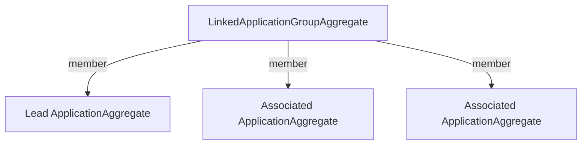

# Linked Applications

Linked applications are represented as a group with exactly one lead and one or more members. The
group is a separate aggregate because membership is a rule shared by several applications; no
single application should own the whole list.

## The model

Application creation does not create or extend linked groups.

## Linking applications explicitly

1. Create each application normally with `POST /api/v0/applications`.
2. Call the explicit application-link endpoint for the source application with an
   `ApplicationLinkRequest`.
3. `LinkApplicationCoordinator` validates the request and asks
   `ApplicationGroupRouteResolver` to lock the source and target routes. When the target is already
   linked, include its `linkedGroupVersion` token as last read; omit that value when the target is
   standalone. The coordinator also locks the joining applications' work-item routes and dispatches
   `DelegateAssignmentToGroupCommand` to each joining application in ascending ID order; each
   returns its caseworker if it is an active manual work item.
4. If both applications are standalone, the coordinator dispatches
   `EstablishLinkedApplicationGroupCommand` with a new group ID. The target application becomes the
   lead and the source application becomes the first associated member, passing both delegated
   assignments to the group.
5. If the target application already belongs to a linked group and the source is standalone, the
   coordinator dispatches `AddApplicationToLinkedGroupCommand` with the delegated assignment.
6. If both applications are already in the same group, the request is an idempotent success.
7. `LinkedApplicationGroupAggregate` emits `LinkedApplicationGroupCreatedEvent` or
   `MemberAddedToGroupEvent`, followed by `LinkedGroupAssignedEvent` when the joining rules change
   the group's caseworker; route, application, list-index, group, and history projections update
   from those events.

Joining an existing group requires the target group's version. The aggregate checks that version
and rejects a stale request with 409. A successful membership change advances the version; an
already-linked request remains an idempotent success regardless of the supplied version.

## Why linking uses durable routes

`ApplicationGroupRouteProjection` records a `STANDALONE` route for every
`ApplicationCreatedEvent` and transitions routes to `LINKED_GROUP` when group events commit.
The resolver locks the relevant route rows before choosing the link action, preventing concurrent
requests from placing one source application into multiple groups.

The resulting behaviour is:

- creation returns without waiting for or dispatching linked-group commands;
- a missing source or target route produces a 404 on the explicit link request;
- a source application already in a different group produces a link conflict;
- duplicate delivery remains idempotent in the group aggregate and route projection.

## Important rules

- An application cannot be linked to itself.
- Source and target applications must have the same non-null submission office code.
- Source and target applications must already have routes, which are created from
  `ApplicationCreatedEvent`.
- A standalone target becomes the group lead when the first group is established.
- A standalone source can join an existing target group.
- A source application already in another group cannot be moved by this command.
- Existing members do not produce duplicate group events.
- Prior Authority drafts can be created for a standalone application or the current group lead, but
  never for an associated application. The create-draft coordinator locks the write-side route and
  validates the current lead in the linked-group aggregate before it persists the draft.
- The lead can change, but the current lead cannot be removed. Make another member the lead first.
- Removing an associate from a group of more than two members leaves the group intact. Removing an
  associate from a two-member group dissolves it instead of leaving a one-member group.
- A dissolved group is terminal and its group ID is never reused. Applications released from a
  group can subsequently be linked into a new group.

## Assignment of linked applications

### Ownership

`LinkedApplicationGroupAggregate` owns one shared work-item assignment for its members. A
`LinkedGroupAssignedEvent` or `LinkedGroupUnassignedEvent` changes that assignment once on the
command side; the command does not fan out assignment commands to member applications.
`ApplicationState.assignmentGroupId` records that assignment ownership has been delegated. Direct
assignment and unassignment commands against a grouped application are rejected.

### Active members only

The shared assignment is shown only for active manual work items: applications that are ready for
manual assessment and not decided. Applications that are not ready, auto-granted, or already
decided are not assigned or updated by group assignment. When an application is decided while in a
group, its shown caseworker remains the caseworker recorded at decision time.

### Joining

When two standalone applications form a group, their assignments are delegated before the group is
created. The resulting group caseworker and active-member changes are:

| Lead assignment | Joining member assignment | Group caseworker | Assignment event after group creation | Active-member assignment change |
|---|---|---|---|---|
| C1 | none | C1 | Yes | Joining member: none → C1 |
| C1 | C2 | C1 | Yes | Joining member: C2 → C1 |
| none | C2 | C2 | Yes | Lead: none → C2 |
| none | none | none | No | None |
| C1 | C1 | C1 | Yes | None |

When adding a member to an existing group, a member's existing active assignment is reconciled
with the group's assignment:

| Existing group assignment | Joining member assignment | Resulting group assignment | Additional assignment event | Changes shown |
|---|---|---|---|---|
| C1 | none | C1 | No | Joining member inherits C1 |
| C1 | C2 | C1 | No | Joining member changes C2 → C1 |
| none | C2 | C2 | Yes | Existing active members change to C2 |
| none | none | none | No | None |
| C1 | C1 | C1 | No | None |

Not-ready members have no work-item row to update; their assignment is inherited when they later
become ready.

### Assignment tokens

The work list's `assignmentVersion` is an opaque token naming both the owner of the assignment
(the individual item or the linked group) and its version. For a grouped item the owner is the
group, so assigning or unassigning any active member changes the shared assignment and the token
shown for every active member. Joining or leaving changes the owner; tokens read before that change
name the old owner and receive 409 `the assignment version is stale`. Re-read the work list before
retrying. When an active member leaves, its direct assignment version becomes
`max(its own version, the group's version) + 1`.

Clients must pass the assignment token back unchanged as `expectedAssignmentVersion`; they must not
parse it. For examples of assignment and unassignment failures, see
[Endpoint errors](endpoint-errors.md#assignment-tokens).

### Readiness inside a group

When a grouped application becomes ready for manual assessment, its work-item route is created with
the linked group as assignment owner. The coordinator records readiness and dispatches
`InheritLinkedGroupAssignmentCommand`; if the group is assigned, the member inherits that
caseworker. The auto-grant outcome endpoint continues to allow either a named API caseworker or
the `LAA_DECIDE_AUTO_GRANT` service role, preserving the existing caller authorization.

### Decisions inside a group

Before deciding a grouped application, `MakeApplicationDecisionCoordinator` validates the supplied
caseworker against the current linked-group assignment. The group must be assigned to that
caseworker. If validation succeeds, the application decision command records the validated group
owner, and its work-item route is removed. If the group is unassigned, or assigned to another
caseworker, the request returns 409 without recording the decision.

### Leaving a group

When an application leaves a group or a two-member group is dissolved, the coordinator reclaims
assignment ownership for each leaving application in ascending ID order. An active manual work
item retains the group's caseworker, but now has a direct assignment token; its version advances to
`max(its own version, the group's version) + 1`. A not-ready member receives no work-list update
until it becomes ready. A decided member keeps the caseworker shown at decision time.

### Prior authorities

A prior authority created for a group lead has its own standalone work-item route and assignment.
Assigning or unassigning it changes only the prior authority; the linked group's assignment is
unaffected.

### Read side

The subscribing `work-item-route` projection records each work item's command authority as
`STANDALONE` or `LINKED_GROUP` (with `group_id`). Four independent query projections each maintain
one private tracking table for linked-group assignment: work list, application, list index, and
history. Each member row carries the group's caseworker and assignment version as processed by
that projection, along with the application's activity and shown assignment. Their processors each
use one processing lane to order related events within that projection; this does not make the
projections globally synchronous. The tracking stores are owned by their respective projections
and are cleared when those projections reset.

Assignment history is written per active member whose displayed caseworker changes. It records the
request actor, not a separate assignment event per member on the command side.

### Lock rule

Any request that changes a linked group, changes the assignment of an active manual-assessment
application in a group, records an application's readiness for manual assessment in a group, or
decides an active manual-assessment application in a group, must lock that group's
`application_group_route` rows before dispatching its first command, in the lock order in
[ADR 0005](adr/0005-linked-group-owns-assignment.md). Terminal auto-grant decisions are exempt:
an auto-granted application is never active as a manual-assessment work item, has no work-item
route, and `RecordAutoGrantOutcomeUseCase.record(Object)` dispatches its decision directly. The
related projections process events in one lane and rely on coordinated transactions committing
in global-index order; nothing checks this rule at runtime, so review every new coordinator
against it.

## Changing the lead

`POST /api/v0/applications/{id}/make-lead` makes the addressed associate the lead. The previous
lead remains a group member as an associate. Calling the endpoint for the current lead is an
idempotent success and does not append an event.

The request body supplies `linkedGroupVersion`. A successful lead change increments the group
version and emits `LinkedApplicationGroupLeadChangedEvent`. It does not change
`application_group_route`: routes identify group membership, not the current lead.

## Removing an application / dissolution

`POST /api/v0/applications/{id}/unlink` removes an associate from its group. The lead cannot be
removed; change the lead before unlinking that application. Removing an associate from a group
larger than two emits `MemberRemovedFromGroupEvent`. Removing one of exactly two members emits one
`LinkedApplicationGroupDissolvedEvent`, so projections never see an active one-member group.

The coordinator then reclaims assignment ownership for the leaving member (or both former members
on dissolution), preserving the current group caseworker for active work items and giving each a
new direct assignment token.

The request body supplies the group's `linkedGroupVersion`. A successful removal or dissolution
advances that version. Once a group is dissolved, its former members have standalone routes and can
be linked again through the regular link endpoint.

## Linked-group version and concurrent changes

New groups start at version 0. Each subsequent group event that changes membership or leadership
(member added, lead changed, member removed, or dissolution) increments the version by one. The
version is exposed as `linkedGroupVersion` on application detail and list responses; it is absent
for a standalone application. Link requests use the target group's version and require it when
joining an existing group. Make-lead and unlink requests require the version the caller last read.

A version conflict returns 409. Since application and group query projections update independently,
a GET immediately after a successful command can briefly return the preceding version or membership.
Clients should re-fetch and retry using the latest `linkedGroupVersion` after a conflict.

`linkedGroupVersion` is an opaque token that encodes the group ID and group version. Clients must
pass it back unchanged and must not parse it. The server checks the token's group against the locked
route group before dispatching, and the aggregate checks the version. A token for a different group,
such as a previously dissolved group, returns 409 even if the version numbers match.

The token format is unpadded URL-safe Base64 of `v1:linked-group:<groupId>:<version>`. It is not
signed and is always validated against write-side state. The generic codec is
`version/VersionToken`, so other resources can adopt it.

Every group mutation locks all route rows for that group with `PESSIMISTIC_WRITE`, in ascending
application-ID order. Link/add also locks its target route. These locks serialize add, lead change,
and removal before the group command is dispatched; aggregate version validation remains the
authoritative backstop.

## Where the resulting data appears

- The group event stream is the authoritative record of group membership.
- `application_group_route` is the durable write-side routing table for link commands.
- `work_item_route` stores each work item's command authority (`STANDALONE` or `LINKED_GROUP`) and
  `group_id` when assignment belongs to a group.
- The work-list, application, list-index, and history projections each own one disposable
  assignment-tracking table, rebuilt by that projection's replay. Each member row stores the
  group's caseworker and assignment version.
- `application_current_state.linked_group_id` identifies the group for application queries;
  membership and lead lookups use the group ID, not `lead_application_id`.
- `linked_application_group_current_state` is the disposable group read model and carries the
  public group version. Its row is deleted when the group is dissolved.
- Application detail and list responses use the group projection to populate `isLead`,
  `linkedApplications`, and `linkedGroupVersion`. These projections are asynchronous and may lag
  independently.
- `ApplicationHistoryProjection` writes `APPLICATION_GROUP_CREATED` for the lead and
  `APPLICATION_GROUP_JOINED` for each associated member, `APPLICATION_GROUP_LEAD_CHANGED` for
  both old and new leads, `APPLICATION_GROUP_LEFT` for a removed application, and
  `APPLICATION_GROUP_DISSOLVED` for the remaining former lead when a group dissolves.
- Assignment changes are written to history per active member whose displayed caseworker changes;
  these rows use `ASSIGN_APPLICATION_TO_CASEWORKER` or `UNASSIGN_APPLICATION_TO_CASEWORKER`.

When changing linking, update the command handler, route resolver/projection, aggregate, and
projection tests. Application creation tests should continue to prove create alone leaves a
standalone route and creates no linked group.

## Projection sequencing, lag, and list-index assessment

`ApplicationProjection` uses a bare class-level `@SequencingPolicy`; Axon's default
`SequentialPolicy` places all its event handlers in one lane. This serializes creation, membership,
notes, and other full-row writers within that projection. It prevents a group event from preceding
application creation in that projection, a stale non-group full-row save from overwriting newer
membership there, and membership events moving G1 to G2 from being applied out of order. Keep this
processor pooled and streaming; the policy is not a global event ordering mechanism.

The application and list-index policies serialize handlers only within their respective
processors. The group and history processors remain independent, and all these query models may lag
one another. Neither sequencing policy establishes a global order across processors.

A query-owned per-application membership model is an alternative: store a nullable group ID, a
removal tombstone, and event ordering, then hydrate group details from the group read model. It can
reject stale membership updates without serializing all application-row writes, but remains
eventually consistent. This model is distinct from `application_group_route`, the durable write-side
routing table for link commands; GET/list membership comes from query-side data.

`ApplicationListIndexProjection` has its own bare class-level `@SequencingPolicy` on its pooled
processor. This serializes its application-row event handlers across aggregate IDs, preventing the
tested creation/group-event overwrite and G1-to-G2 reordering within that index projection. It is
independent of `ApplicationProjection` and does not order the index against application, group, or
history projections. Those processors can still lag one another. The index's `stream_version` is
not a conditional write guard, and `projectionPosition` is a hash of the event identifier, not an
ordered event position. The list query uses the index for filtering and paging, while
linked-application summaries derive from separate application and group projections; do not infer
cross-processor freshness from the sequencing policies.
