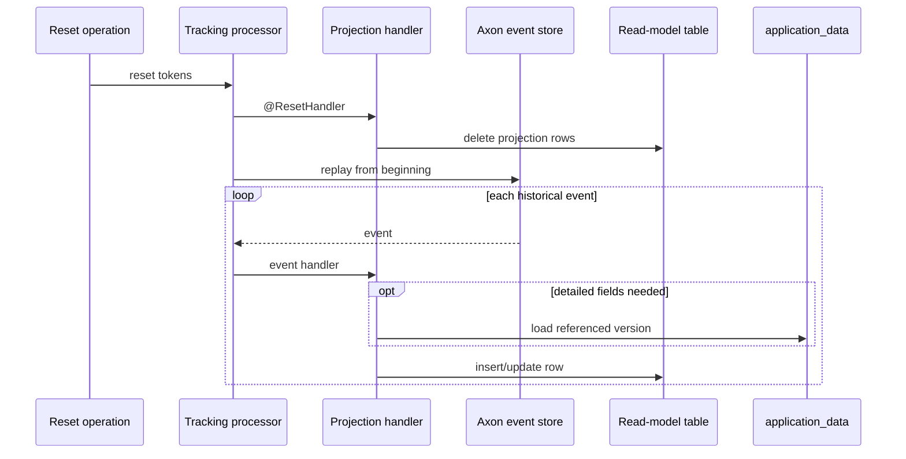

# Projections and Replay

Projections are query models derived from events. They are disposable: they can be cleared and
rebuilt without changing aggregate event streams or immutable application-data versions.

## Processing groups

| Processing group | Mode | Builds |
|---|---|---|
| `application-projection` | Pooled streaming | `application_current_state` |
| `lifecycle-stream` | Pooled streaming | `lifecycle_stream`, read by application history |
| `linked-application-group-projection` | Pooled streaming | `linked_application_group_current_state` |
| `application-list-index-projection` | Pooled streaming | `application_list_index` |
| `work-list-projection` | Pooled streaming | `work_list_item` |
| `application-group-route` | Subscribing | `application_group_route`, synchronously in the command transaction |

Processors receive events with their content fields `null`, except those for projection classes
marked `@ReadsEventContent` (`ApplicationProjection` on `application-projection` and
`PriorAuthorityProjection` on `prior-authority-projection`), whose event source rejoins content
from `event_content` by event identifier. Adding `@ReadsEventContent` to a projection needs review
of what content it stores and how erasure reaches it. See
[ADR 0007](adr/0007-event-content-is-stored-beside-its-event.md).

`application-projection` owns the event-derived `application_current_state.submitted_at`.
`application-list-index-projection` owns the lead-proceeding name/code columns and the
event-derived `application_list_index.submitted_at` used for submitted-date sorting.
`work-list-projection` owns `work_list_item`, including `submitted_at`, which records an
application's true creation/submission time. `ready_at` records when an application became ready
for manual assessment. For Prior Authorities, both timestamps record the submission time.

Migration V25 adds event-derived `submitted_at` to `application_current_state` and code columns to
`application_list_index` and `work_list_item`. Existing rows are not backfilled by the migration;
their new values are rebuilt only by replaying the owning processors. Required detail/list response
fields must not be relied on until the application and list-index processors have caught up and
their event times and codes have been checked against the creation events and event-versioned
proceedings.

Migration V32 adds `assignment_version` to `application_current_state` and
`prior_authority_current_state`. The value is set from the absolute `assignmentVersion` carried by
`WorkItemAssigned` and `WorkItemUnassigned`, making event replay idempotent. Notes and decisions do
not change the value.

Tracking processors maintain tokens and run independently of the command thread. A failure stops
token progress past the failing event, allowing recovery without silently skipping it. The
application command handler dispatches linked-group commands after locking the relevant routes;
the subscribing route projection updates those routes in the same transaction, as described in
[Linked applications](linked-applications.md).

## Prior-authority assignment

`prior-authority-projection` owns `prior_authority_current_state`, including the caseworker ID
returned as `assignedTo` by `GET /prior-authorities/{id}`. `WorkItemAssigned` sets the caseworker ID
and assignment version; `WorkItemUnassigned` clears the caseworker ID and sets the new assignment
version. The detail response retains the last assignee after a decision removes the work-list row.

Migration V33 adds the nullable `caseworker_id` column. It does not backfill existing assignments.
After deploying the migration and projection change, an operator must reset and replay
`prior-authority-projection` through the approved Axon processor lifecycle. Preserve the event store,
prior-authority data versions, and draft storage. Wait for catch-up and compare detail `assignedTo`
and `assignmentVersion` with the latest assignment events before treating historical rows as rebuilt.
The detail and work-list processors run independently, so their responses can still differ briefly
while either processor catches up.

## Current application projection

`ApplicationProjection` stores thin, searchable control state and the current
`applicationDataVersion`. Query handlers hydrate detailed fields from `application_data`.

Decision and manual-ready events both advance the public and data versions. A replay of
`ApplicationReadyForManualAssessmentEvent` therefore restores the pointer to the immutable payload
containing `autoGranted=MANUAL`; no command handler or external side effect is invoked during replay.
List queries can filter that hydrated value with `autoGranted=MANUAL`, which deliberately excludes
null outcomes, while identifier lookup remains unfiltered.

The aggregate event stream remains authoritative while this tracking projection catches up.
Repeating a stale Decision command after its event committed returns the public version-conflict
response without appending another event. Repeating manual readiness returns the idempotent
already-recorded response without appending another event. Consumers can therefore retry after a
stale read safely; once this processor advances, the query model exposes the one recorded outcome.

For a single application, a missing referenced payload means no hydrated application is returned.
For list queries, payloads are batch-loaded to avoid one lookup per row. Linked-group rows are also
batch-loaded for the result page by the `linked_group_id` stored on each application row. The
`isLead` value is derived by comparing the application ID with the lead ID on the group row; a
group row is deleted when its group is dissolved.

### Application projection sequencing

Use a bare class-level `@SequencingPolicy` on `ApplicationProjection` with Axon's default
`SequentialPolicy`, while keeping the `application-projection` processor pooled and streaming. A
shared lane prevents a membership event from preceding application creation, a stale non-group
full-row save from overwriting membership, and G1-to-G2 membership events from being applied out of
order.

This policy orders handlers only within `application-projection`. `ApplicationListIndexProjection`
also has its own sequencing policy, but its pooled processor remains independent of the
application, group, and lifecycle-stream processors. Their query models may lag one another; neither policy
establishes a global event order.

A query-owned membership model can store a nullable group ID, removal tombstone, and event ordering,
then hydrate group details from the group read model. It remains eventually consistent and is
separate from `application_group_route`, the write-side routing table for link commands.

`ApplicationListIndexProjection` has its own bare class-level `@SequencingPolicy` on its pooled
processor. This serializes its application-row handlers across aggregate IDs; real-Axon/PostgreSQL
race tests verify that creation/group-event and G1-to-G2 membership races are ordered within the
index projection. This policy does not synchronize the index with the application, group, or
lifecycle-stream processors, whose query models may lag independently. `stream_version` is not a
conditional write guard; `projectionPosition` is a hash of the event identifier, not an ordered
event position. The list query uses the index for filtering and paging, while linked-application
summaries derive from the separate application and group projections. Do not infer consistency
between these independently advancing projections.

Document upload events populate the `uploaded_documents` JSONB column in `application_current_state`.
This list contains filename-free metadata and a deletion flag, not the assembled API response.
The same handler advances the data-version pointer when present, keeping metadata and filename
content aligned within the existing `application-projection` processor. Duplicate document IDs
are not appended again. The list index also records the upload timestamp for last-updated sorting.

New uploads occur before `ApplicationCreatedEvent`. Their handler seeds a thin current-state row to
retain document metadata, but no immutable application-data payload exists yet, so the ordinary
Application GET still returns not found while the Application is in draft. Creation preserves the
projected document list and references the submission payload containing the filenames. This ordering
is maintained by the same processor and survives reset/replay. The pre-submission metadata row must
not be used as the authoritative draft lifecycle check.

Query hydration loads the filename map from the payload referenced by the current-state row.
Application detail mapping joins by document ID, excludes deleted documents, and orders active
documents by upload time then document ID. It does not read aggregate state or call SDS for each
document. Unknown legacy filenames remain absent rather than causing documents to disappear.
The application document deletion endpoint is not implemented yet; uploads start with `deleted=false`.

Migration V21 initializes the metadata column to an empty list. For an existing database whose
processor has already passed historical document uploads, reset and replay `application-projection`
to populate those documents. Replay `application-list-index-projection` as well to include their
upload timestamps in sorting. Preserve the event store and `application_data` during either reset.
New draft uploads become visible in Application details after submission and once the asynchronous
projection catches up; the upload response does not add a read-your-write guarantee.

## Application history

Application history is not a projection. `ApplicationHistoryQueryHandler` builds it when queried:
`LifecycleStreamReader` loads the events named by the application's lifecycle stream, in stream
order, and `ApplicationHistoryMapper` turns each event into the application's public history entry,
if it has one. Nothing is stored, so there is nothing to replay when the mapping changes.

The lifecycle stream holds one pointer per event per genesis application (see
[ADR 0006](adr/0006-every-event-names-its-genesis.md)). A group change appears in the history of
every application it names: the lead and members get `APPLICATION_GROUP_CREATED` or
`APPLICATION_GROUP_JOINED`; an added or removed member gets `APPLICATION_GROUP_JOINED` or
`APPLICATION_GROUP_LEFT`, and the other members get `APPLICATION_GROUP_MEMBER_ADDED` or
`APPLICATION_GROUP_MEMBER_REMOVED`; a lead change appears for every member; dissolution records
`APPLICATION_GROUP_LEFT` for the removed application and `APPLICATION_GROUP_DISSOLVED` for the
rest. Group events stored before they recorded the group's members appear only for the
applications they name.

Application decision and note descriptions come from the referenced `application_data` version.
If it is absent, the entry remains with a `null` description. Prior Authority decisions use
`prior_authority_data`: without that version the entry still reports outcome and time, but no
justification. Events and linked-group justifications are batch-loaded; these versioned payloads
are looked up per qualifying entry, so query count can grow with history length.
Assignment and unassignment entries have no description. Data-store errors are not treated as missing versions and
continue to fail the query. Caseworker attribution comes from event metadata when present, so
historical events without authenticated-user metadata have no caseworker attribution.

Prior Authority assignment and unassignment entries take their Prior Authority type from the
`PriorAuthoritySubmittedEvent` in the same stream; determining that type needs no payload lookup. A Prior
Authority can only be assigned once submitted, so an assignment with no submission in the stream
fails the query with `ApplicationHistoryIntegrityException`.

If the lifecycle stream names an event the store does not hold, the query fails with
`ApplicationHistoryIntegrityException` rather than returning partial history. History is only as
current as the asynchronous `lifecycle-stream` processor. Events stored before the lifecycle
stream recorded them are included once the processor replays them; legacy events that name no
genesis (see the ADR) never appear.

**Rollback boundary:** V35 removes `application_history`, `prior_authority_history` and their
processor tokens. No data reset is needed. After V35, do not roll back to a release that uses
those tables without first restoring the schema and rebuilding the old projections.

## Reset and replay

Each tracking projection has a `@ResetHandler` that clears only its own read table. After reset, its
processor replays events from the event store and rebuilds the rows.

Do not delete Axon event rows or `application_data` as part of a projection reset. Those are source
records, not projections.

After deploying the read-model migration, the existing rows are not backfilled. Stop
`application-projection`, `application-list-index-projection`, and `work-list-projection`; reset
each processor only through its Axon lifecycle API so its reset handler clears only its own table
and its tokens restart from the beginning; then resume all three processors. Wait for each processor
to catch up before relying on the rebuilt values. Compare table counts and representative
`submitted_at` values with their creation events, compare stored legal codes with the proceedings in
the event-pinned `application_data` versions, and compare `work_list_item.submitted_at` with the
readiness or prior-authority submission events. Historical drafts must replay their draft-start
event before their creation event so `created_at` retains the original draft time. Do not mark the
replay complete until all old rows have been rebuilt. No repository admin CLI executes this reset;
follow the processor-lifecycle operation in
[Running and operating](running-and-operating.md#projection-reset-and-replay). The process for
performing this reset still needs to be established.

## Development checklist

When adding or changing an event:

- update every projection that consumes it;
- make reset handlers clear any new read tables;
- make event handling idempotent where replay could encounter existing rows;
- test normal handling, reset, replay, transient failure recovery, and permanent failure token
  behaviour;
- decide whether query hydration needs an `applicationDataVersion` pointer;
- preserve event metadata such as `X-Service-Name` when it is part of audit history.

The module's in-memory recovery tests cover reset/replay and processor failure semantics. The
PostgreSQL integration tests prove that the same projections work against the real Axon/JPA schema.
