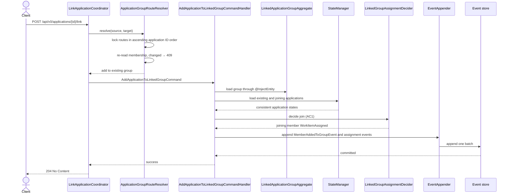
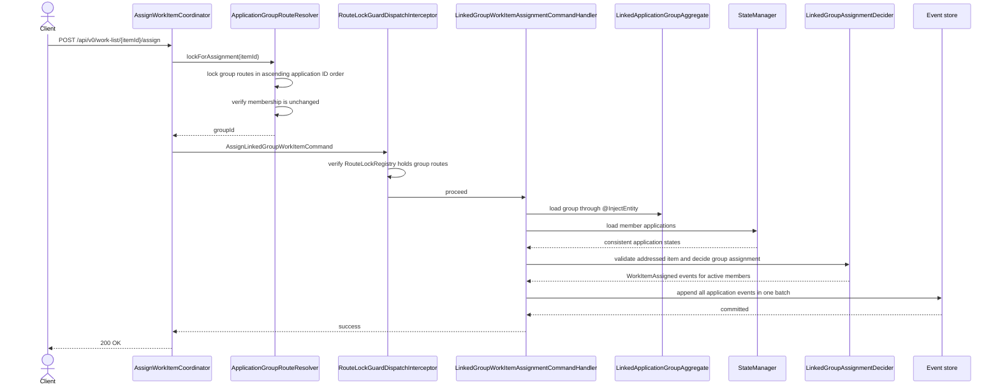
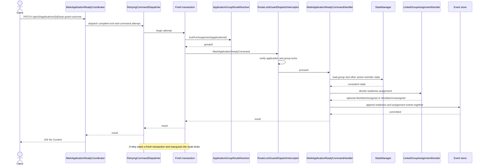

# Linked-group assignment

Assignment is stored on each application. Coordinators lock the write-side routes before sending one
command; handlers load command-side aggregate state, decide and append all resulting events in one
batch.

## Link: add an active member to an assigned group (AC1)

## Group assign

## Readiness for a linked application

