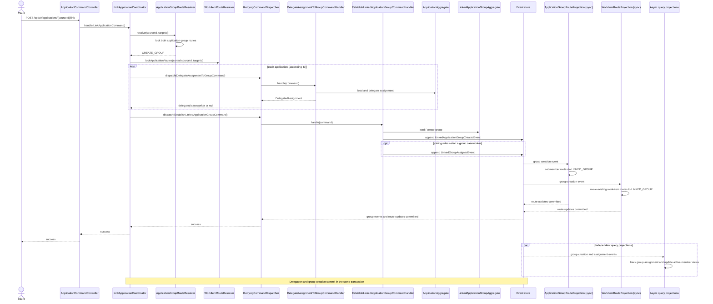
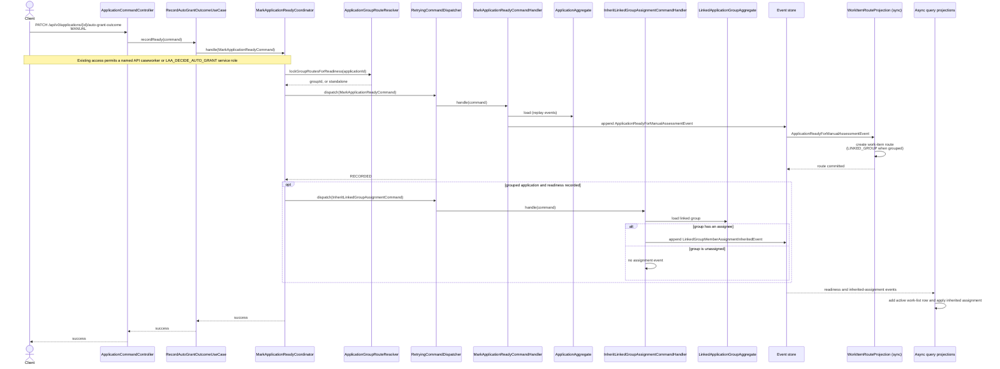
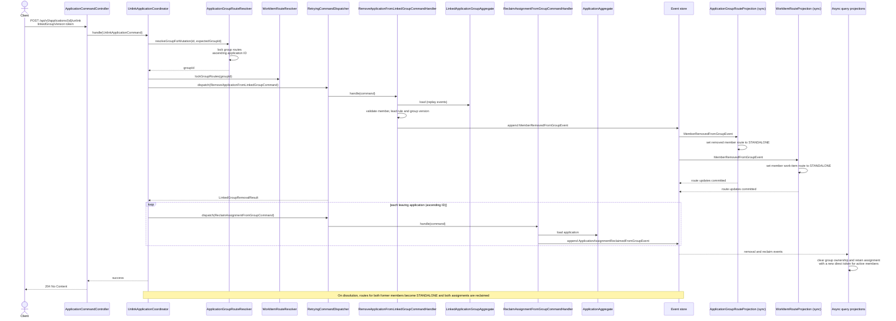

# Linked-Group Assignment

These diagrams show how one aggregate owns a linked group's shared assignment, how ownership moves
when applications join or leave, and how readiness and decisions use the group assignment. Query
projections update asynchronously and each projection maintains its own assignment-tracking tables.

## 3.1 Assign a linked-group work item

```mermaid
sequenceDiagram
    actor Client
    participant Controller as WorkListCommandController
    participant Coordinator as AssignWorkItemCoordinator
    participant Resolver as WorkItemRouteResolver
    participant Dispatcher as RetryingCommandDispatcher
    participant GroupHandler as AssignLinkedGroupCommandHandler
    participant Aggregate as LinkedApplicationGroupAggregate
    participant EventStore as Event store
    participant Projections as Async work-list, application, list-index and history projections

    Client->>Controller: POST /api/v0/work-list/{itemId}/assign<br/>expectedAssignmentVersion token
    Controller->>Controller: decode opaque token (invalid → 400)
    Controller->>Coordinator: handle(AssignWorkItemCommand)
    Coordinator->>Resolver: lockRoute(itemId)
    Resolver->>Resolver: peek route, lock group routes<br/>ascending application ID
    Resolver->>Resolver: lock work-item route
    Resolver-->>Coordinator: LINKED_GROUP, groupId
    Coordinator->>Coordinator: token owner must equal groupId<br/>(otherwise stale → 409)
    Coordinator->>Dispatcher: dispatch(AssignLinkedGroupCommand)
    Dispatcher->>GroupHandler: handle(command)
    GroupHandler->>Aggregate: load (replay events)
    GroupHandler->>Aggregate: validate membership, version and unassigned state
    GroupHandler->>EventStore: append LinkedGroupAssignedEvent
    EventStore-->>Dispatcher: committed event
    Dispatcher-->>Coordinator: success
    Coordinator-->>Controller: success
    Controller-->>Client: 204 No Content

    par Independent projections
        EventStore-->>Projections: LinkedGroupAssignedEvent
        Projections->>Projections: update active members' assignments<br/>and append changed-member history rows
    end
    Note over Aggregate,EventStore: One group command and one event; no assignment fan-out to applications
    Note over Projections: Not-ready, auto-granted and decided members are not updated
```

## 3.3 Create a linked group and delegate assignment



## 3.11 A grouped application becomes ready



## 3.6 An active member leaves a group



## 3.13 Decide an application in a linked group

```mermaid
sequenceDiagram
    actor Client
    participant Controller as ApplicationCommandController
    participant UseCase as MakeApplicationDecisionUseCase
    participant Coordinator as MakeApplicationDecisionCoordinator
    participant Resolver as WorkItemRouteResolver
    participant Dispatcher as RetryingCommandDispatcher
    participant ValidateHandler as ValidateLinkedGroupAssigneeCommandHandler
    participant GroupAggregate as LinkedApplicationGroupAggregate
    participant DecisionHandler as MakeApplicationDecisionCommandHandler
    participant AppAggregate as ApplicationAggregate
    participant EventStore as Event store
    participant WorkRoutes as WorkItemRouteProjection (sync)
    participant Projections as Async query projections

    Client->>Controller: PATCH /api/v0/applications/{id}/decision
    Controller->>UseCase: execute(MakeApplicationDecisionCommand)
    UseCase->>Coordinator: handle(command)
    Coordinator->>Resolver: lockRouteIfPresent(applicationId)
    Resolver->>Resolver: lock group and work-item routes
    Resolver-->>Coordinator: LINKED_GROUP, groupId
    Coordinator->>Dispatcher: dispatch(ValidateLinkedGroupAssigneeCommand)
    Dispatcher->>ValidateHandler: handle(command)
    ValidateHandler->>GroupAggregate: load group and validate current assignee
    alt group is unassigned
        ValidateHandler-->>Dispatcher: 409 it is unassigned
        Dispatcher-->>Coordinator: conflict
        Coordinator-->>Controller: 409
    else supplied caseworker is not the group assignee
        ValidateHandler-->>Dispatcher: 409 not its current assignee
        Dispatcher-->>Coordinator: conflict
        Coordinator-->>Controller: 409
    else supplied caseworker is the current group assignee
        ValidateHandler-->>Dispatcher: validation succeeded (no event)
        Coordinator->>Dispatcher: dispatch decision with groupAssigneeValidatedFor
        Dispatcher->>DecisionHandler: handle(command)
        DecisionHandler->>AppAggregate: load and decide
        DecisionHandler->>EventStore: append ApplicationDecisionMadeEvent
        EventStore->>WorkRoutes: ApplicationDecisionMadeEvent
        WorkRoutes->>WorkRoutes: remove work-item route
        WorkRoutes-->>EventStore: route deletion committed
        EventStore-->>Projections: decision event
        Projections->>Projections: mark application inactive;<br/>retain caseworker shown at decision time
        Dispatcher-->>Coordinator: success
        Coordinator-->>Controller: success
        Controller-->>Client: success
    end
    Note over GroupAggregate,AppAggregate: Group validation and application decision run under the group's route locks
```
