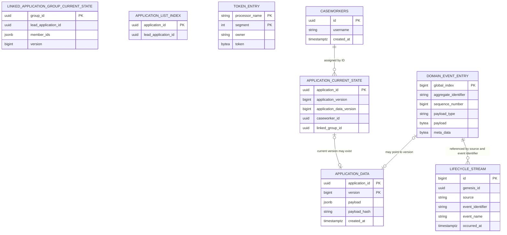

# Storage Model

The module uses one PostgreSQL schema, `axon`, for source records, versioned sensitive data, and
disposable query projections.

The relationships to `application_data` are logical, not database foreign keys. The event payload
contains `applicationId` and `applicationDataVersion`; the current-state row stores the same
pointer. Avoid adding a foreign key from the event store because event payload fields are serialized
data, and retention must be able to delete application rows while thin events remain.

## Ownership and lifecycle

| Table | Role | Authoritative? | Mutable? | Reset/replay? | Retention behaviour |
|---|---|---:|---:|---:|---|
| `domain_event_entry` | Aggregate event streams | Yes, for control state and transitions | Append-only | Source of replay | Retained by this design |
| `event_content` | Erasable content of individual events, keyed by event identifier | Yes, for that content | Insert-only; deletes and updates rejected except erasure | No; rejoined on load | Erasure replaces the content and stamps `erased_at`; the row is kept |
| `snapshot_event_entry` | Optional aggregate snapshots | No; optimization only | Replaceable | Rebuilt/discarded | Must not be the only source |
| `application_data` | Complete sensitive payload versions | Yes, for detailed content | Append-only | Not a projection | Deleted only through retention function |
| `application_current_state` | Current application query model | No | Yes | Yes | Pointer may outlive deleted payload |
| `lifecycle_stream` | Event pointers per genesis application, read by application history | No | Append during handling | Yes | Pointer may outlive deleted payload |
| `linked_application_group_current_state` | Group query model | No | Yes | Yes | Rebuilt from group events |
| `token_entry` | Tracking processor positions and claims | Operational state | Yes, via Axon | Reset through processor APIs | Not application retention data |
| `caseworkers` | Caseworker reference directory | Yes for caseworker existence | Yes | No | Requires its own policy |

Stored event payloads hold only the fields listed in each event type's kept-field schema; the rest
of the event is a row in `event_content`, written in the same transaction and joined back when an
aggregate loads. Its foreign key to `domain_event_entry` is deferred to the end of the transaction.
Every event whose type has content fields has a row; a missing row is an error, not erased content.
See [ADR 0007](adr/0007-event-content-is-stored-beside-its-event.md).

## Event and data version relationship

An application event stream has Axon's `sequence_number`, while the application domain also uses
two explicit versions:

- `applicationVersion` implements the public optimistic-lock contract.
- `applicationDataVersion` selects a row from `application_data`.

These numbers can differ. Notes advance `applicationDataVersion` without advancing
`applicationVersion`, while Axon's event sequence advances for every event on the application
stream. Code must use the named field appropriate to its purpose rather than assuming the numbers
remain aligned.

## Projection data

`application_current_state` deliberately excludes most detailed application content. Query handlers
hydrate it from the referenced `application_data` row. Application history is read from the
events named by `lifecycle_stream`, which stores only event pointers. Decision and note
descriptions are hydrated from the `application_data` version the event references when queried.
Events without application data (including group and assignment events) have no version pointer.

Group events are stored on their own event stream and projected into
`linked_application_group_current_state`. Application queries use
`application_current_state.linked_group_id` to find the group row by `group_id`; the lead is
derived from that row rather than using the group's lead as a lookup key. The group read-model row
contains the public group version and is deleted when a dissolution event is projected.

`LifecycleStreamProjection` writes one pointer per root application named by the event,
unique on `(genesis_id, source, event_identifier)`. The link to the event is logical, not a
foreign key. For example, a member removal names the departing and remaining members. Each
gets a pointer to the same event; the history query maps it to a different entry for the
departing member than for those who stayed. It does not consult today's group membership.

## Database controls

The `application_data` migration installs triggers that reject:

- `UPDATE`;
- ordinary `DELETE`;
- `TRUNCATE`.

The security-definer retention function temporarily enables deletion for one application ID. Its
execution permission is revoked from `PUBLIC`; production use requires a deliberately granted role
and an audited workflow.

See [Events and sensitive data](events-and-sensitive-data.md) for the design and
[ADR 0002](adr/0002-separate-sensitive-data-from-domain-events.md) for the rationale.
